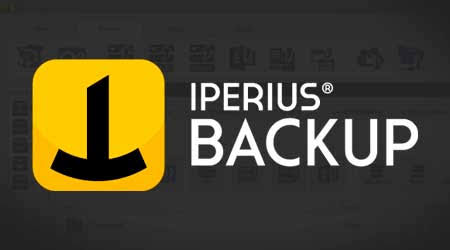
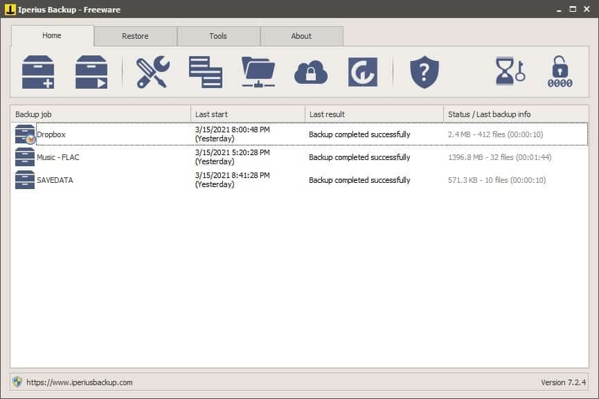

# Iperius Backup for Windows Protection and Recovery

Iperius Backup provides Windows backup tools for files, systems, and supported business workloads.
The product range covers local storage, network destinations, cloud services, and recovery workflows.

This independent Iperius guide focuses on planning backup jobs and checking recovery results.
Iperius Backup capabilities depend on the selected edition and the workload being protected.

[](https://iperius-remote-desktop.github.io/Iperius-Backup/)

The supplied source snapshot belongs to Duplicati, a separate backup application.
Its linked files provide comparative references for storage testing, verification, and interface behavior.
They are not Iperius source code, Iperius job definitions, or Iperius recovery tools.

## Features

When evaluating iperius backup full, map the required workloads to the current edition comparison.
An edition name alone does not describe your backup sources, retention needs, or recovery process.

| Protection goal | Planning question | Recovery check |
| --- | --- | --- |
| Files and folders | Which paths and exclusions define the job? | Restore representative files to a separate location |
| Windows system | Which disks and recovery components are required? | Test the documented recovery procedure |
| Virtual machines | Which hypervisor and versions are supported? | Confirm that the restored guest starts and its services work |
| Databases | Which database-aware method matches the application? | Restore a test database and check application access |
| Microsoft 365 | Which accounts and services need protection? | Recover selected items and verify their contents |
| Off-site copies | Which destination and credentials will be used? | Confirm access independently of the protected computer |

The [official product overview](https://www.iperiusbackup.com/) describes the available workload categories.
Keep a written record of the edition, application version, and relevant platform versions.

For iperius backup server planning, define who will review failed jobs and perform recovery tests.
A job that runs unattended still needs someone responsible for its results.

- Record the required recovery point.
- Estimate the time available for restoration.
- Include destination capacity and retention in the plan.
- Keep recovery instructions accessible when the source computer is unavailable.

The supplied [ConfigAutoTune.cs](Tools/AutoTune/ConfigAutoTune.cs) describes Duplicati performance-tuning parameters.
It can inform a discussion about measuring backup throughput.
Its parameters are not Iperius settings and should not be copied into an Iperius job.

## Backends

Choose a destination for its recovery characteristics as well as its storage capacity.
Consider network availability, account access, transfer time, and the location of recovery credentials.

| Destination | Practical advantage | Question to resolve |
| --- | --- | --- |
| Local storage | Fast access to nearby copies | What happens if the protected machine and disk fail together? |
| NAS or network share | Storage separate from the source computer | Which account can access the destination during unattended runs? |
| Cloud object storage | Off-site storage with provider-specific controls | What retention, access, and retrieval conditions apply? |
| Cloud drive service | Integration with an existing storage account | How will authentication renewal and capacity be monitored? |
| FTP or SFTP server | Remote destination under your administration | Which protocol, permissions, and network route are required? |

The following Duplicati files are storage integration tests supplied with the snapshot:

- [S3Tests.cs](LiveTests/Duplicati.Backend.Tests/S3/S3Tests.cs) covers S3 storage.
- [AzureTests.cs](LiveTests/Duplicati.Backend.Tests/Azure/AzureTests.cs) covers Azure storage.
- [GoogleDriveTests.cs](LiveTests/Duplicati.Backend.Tests/Google%20Drive/GoogleDriveTests.cs) covers Google Drive.
- [OneDriveTests.cs](LiveTests/Duplicati.Backend.Tests/OneDrive/OneDriveTests.cs) covers OneDrive.
- [DropBoxTests.cs](LiveTests/Duplicati.Backend.Tests/Dropbox/DropBoxTests.cs) covers Dropbox.

They illustrate how another project tests remote storage.
They do not establish Iperius compatibility or define credentials for an Iperius destination.

Additional protocol references in the same snapshot are:

- [FTPTests.cs](LiveTests/Duplicati.Backend.Tests/FTP/FTPTests.cs)
- [SSHTests.cs](LiveTests/Duplicati.Backend.Tests/SSH/SSHTests.cs)
- [SMBTests.cs](LiveTests/Duplicati.Backend.Tests/CIFS/SMBTests.cs)
- [WebdavTests.cs](LiveTests/Duplicati.Backend.Tests/Webdav/WebdavTests.cs)

Verify Iperius support for the chosen destination in its own documentation.
A backend available in Duplicati is not automatically available in Iperius.

## Design Principles

A backup plan should explain what is protected and how someone will recover it.
Separate the success of a scheduled run from evidence that the required data can be restored.

- Use clear job names that identify the workload.
- Define retention according to recovery needs.
- Record where encryption credentials are kept.
- Review exclusions when applications or folder locations change.
- Test a representative restore after significant configuration changes.

For iperius backup basic, compare the required sources and destinations with the current feature list.
Do not infer database or virtualization coverage from file-copy capability.

Iperius documents a command for starting an existing backup job.
The following PowerShell example assumes Iperius.exe is in the current directory and the named job already exists.

```powershell
$iperiusExecutable = ".\Iperius.exe"
$backupJobName = "Nightly Documents"
& $iperiusExecutable startbackup $backupJobName
```

Replace the example job name with the intended configured job.
Executing this command starts that job; it is not a preview or a job-creation command.

The [official command-line tutorial](https://www.iperiusbackup.fr/33496/execution-diperius-backup-en-ligne-de-commande/) documents the syntax.
It also describes optional WCS service execution with the configured service credentials.
Confirm command-line availability in your edition before incorporating it into scheduling.

The supplied [Program.cs](Executables/Duplicati.WindowsService/Program.cs) is a Duplicati Windows service entry point.
It is a reference for another application's service structure and does not implement Iperius scheduling.

## Support

A recovery test should answer a specific question.
Choose a known file, restore it to a separate location, and compare it with a stable reference copy.

This PowerShell example compares SHA-256 hashes of two existing files.
Use files representing the same recovery point so that later source edits do not create a misleading mismatch.

```powershell
$referenceFile = ".\reference\sample.pdf"
$restoredFile = ".\restored\sample.pdf"
$referenceHash = (Get-FileHash -LiteralPath $referenceFile -Algorithm SHA256).Hash
$restoredHash = (Get-FileHash -LiteralPath $restoredFile -Algorithm SHA256).Hash
$referenceHash -eq $restoredHash
```

A True result indicates matching hashes for those two files.
It does not verify the entire backup set, application consistency, or a full system recovery.

The example uses Microsoft's [Get-FileHash](https://learn.microsoft.com/en-us/powershell/module/microsoft.powershell.utility/get-filehash) cmdlet.
It reads the selected files without modifying them.

The supplied Duplicati verification references include:

- [DuplicatiVerify.py](Tools/Verification/DuplicatiVerify.py), which checks Duplicati verification data.
- [DuplicatiVerify.ps1](Tools/Verification/DuplicatiVerify.ps1), which provides PowerShell verification tooling.
- [restore_from_python.py](Tools/Commandline/RestoreFromPython/restore_from_python.py), which handles Duplicati restoration.

These tools expect Duplicati data structures.
They should not be presented as readers or validators for Iperius backup formats.



## Reporting Bugs

A useful issue report distinguishes source access, transfer, scheduling, and restoration problems.
Include enough context to reproduce the affected stage without exposing credentials.

- Application version and licensed edition.
- Source type and relevant application or hypervisor version.
- Destination type and protocol.
- Whether the run was interactive, scheduled, or service-based.
- The relevant error text and the time of the attempt.
- Whether a small reproduction job behaves the same way.

Keep account tokens, encryption passwords, and private customer paths out of shared reports.
A concise redacted log is easier to review than an unrelated collection of screenshots.

The supplied [backupRestore.spec.ts](playwright-tests/backupRestore.spec.ts) tests a Duplicati backup-and-restore workflow.
It illustrates how another project structures a repeatable scenario.

## Screenshots

A useful screenshot shows the decision being reviewed and the result of that decision.
For job documentation, make the source selection and destination context understandable.



The supplied [ngaxSourcePicker.spec.ts](playwright-tests/ngaxSourcePicker.spec.ts) tests Duplicati source-picker behavior.
Its page structure and selectors do not describe the Iperius interface.

Capture completion status separately from configuration.
This makes it easier to distinguish a correctly described job from a job that completed successfully.

## Contributing

Documentation changes should clarify an operational decision or correct a verified detail.
Identify the application associated with every command, source reference, and screenshot.

- Preserve the distinction between Iperius features and Duplicati internals.
- Check links against the supplied source tree.
- State whether a procedure was tested or is illustrative.
- Describe the recovery result that a proposed check can establish.

Use the [official Iperius site](https://www.iperiusbackup.com/) for edition comparisons and product-specific guidance.

## Related Search Terms

Iperius, Iperius Backup, iperius backup full, iperius backup server, iperius backup basic, backup, backup-solution, cloud-backup, encryption, windows, disaster-recovery, cloud-storage, sftp, data-protection, restore
